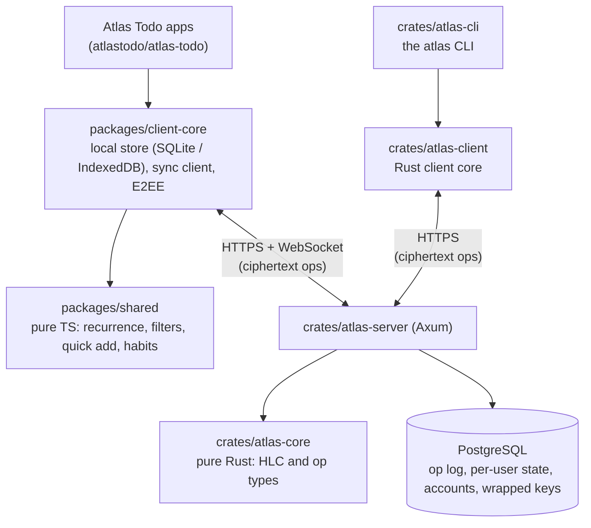

# Atlas

[](https://github.com/atlastodo/atlas/actions/workflows/ci.yml)
[](./LICENSE)
[](https://github.com/atlastodo/atlas/releases/latest)

[](https://scorecard.dev/viewer/?uri=github.com/atlastodo/atlas)

Atlas is the self-hostable, end-to-end-encrypted core behind
[Atlas Todo](https://github.com/atlastodo/atlas-todo): the sync server you run (Rust +
PostgreSQL), the client core the apps are built on, and an `atlas` command-line tool. Your data is
encrypted on your devices; the server stores and relays it without being able to read it. Clients
work fully offline, merge edits per field when they reconnect, and can share encrypted projects
with other people on the same server.

> **Status: pre-1.0.** Only the latest release gets fixes, and the sync protocol still changes:
> keep clients and server on recent versions. The encryption has not been independently audited;
> [SECURITY.md](./SECURITY.md) says what it protects against and what it does not. Keep a JSON
> export of anything you cannot afford to lose.

**Looking for the app?** The to-do app (web, Android and the Linux desktop), its screenshots,
features and downloads live in [atlastodo/atlas-todo](https://github.com/atlastodo/atlas-todo).
Try it at [app.atlastodo.dev](https://app.atlastodo.dev) (a test server that may be reset), or
[self-host it](#self-hosting): the server image here serves the web app too. Website:
[atlastodo.dev](https://atlastodo.dev).

## What is in this repository

- **The sync server** (`crates/atlas-server`): accounts, the encrypted op log, sharing, attachments,
  passkeys and the admin API, shipped as the `ghcr.io/atlastodo/atlas` image (with a pinned
  release of the Atlas Todo web app) and as a NixOS module.
- **The client core**, in TypeScript (`@atlastodo/client-core`, `@atlastodo/shared`,
  `@atlastodo/sdk` on npm and on each release) and in Rust (`crates/atlas-client`): the local
  store, sync client, end-to-end encryption and task rules, kept in agreement by shared test
  vectors.
- **The `atlas` CLI** (`crates/atlas-cli`): a static binary per platform on each release, signed
  in with an API token from Settings, for scripts and tools like n8n. Your data stays end-to-end
  encrypted. See [docs/integrations.md](./docs/integrations.md).

## Architecture



Clients record each edit as an operation on one field, stamped with a hybrid logical clock. The
newest stamp wins per field, so replaying operations in any order gives the same result. The
server keeps an append-only log per user and copies operations on shared projects to every
member. [docs/architecture.md](./docs/architecture.md) covers sync, the clock and the key
hierarchy, [docs/sync-protocol.md](./docs/sync-protocol.md) the wire format, and
[docs/decisions/](./docs/decisions/README.md) why the main choices were made.

## Self-hosting

You need Docker with Compose v2.24 or later. On NixOS, the repository flake has a
`services.atlas` module instead; see [NixOS](./docs/self-hosting.md#nixos).

```sh
git clone https://github.com/atlastodo/atlas.git
cd atlas
cp .env.example .env
# Edit .env and set:
#   POSTGRES_PASSWORD   e.g. the output of: openssl rand -hex 24
#   JWT_SECRET          e.g. the output of: openssl rand -hex 32
docker compose up -d
```

Open <http://localhost:8080> and create an account. One container serves the web app and the
API, and applies database migrations when it starts. Run compose commands from the repository
root so it reads the root `.env`.

The port is published on localhost only. To use it from other devices, put a TLS reverse proxy in
front ([Caddy takes three lines](./docs/self-hosting.md#caddy)), or set `PORT_BIND=8080` in
`.env` to listen on every interface.

Signing up never makes anyone an admin. Create your account, then promote it:

```sh
docker compose exec server atlas-server promote you@example.com
```

The admin panel is the Admin section of Settings, shown to admins only.

[docs/self-hosting.md](./docs/self-hosting.md) has the full settings reference, reverse-proxy
examples, backups, upgrades and closing registration.

Docker (with compose) is the supported way to run the server; the NixOS module is maintained on a
best-effort basis. The Android, desktop and iOS apps sign in to any server from the _Server URL_
field on their sign-in screen; see [atlastodo/atlas-todo](https://github.com/atlastodo/atlas-todo).

## Getting help

- Questions, self-hosting help and ideas: [Discussions](https://github.com/atlastodo/atlas/discussions).
- Bugs and concrete feature requests for the server, CLI and packages:
  [Issues](https://github.com/atlastodo/atlas/issues/new/choose). App bugs (UI, Android, desktop,
  accessibility) go to [atlastodo/atlas-todo](https://github.com/atlastodo/atlas-todo/issues).
- Vulnerabilities: privately, as [SECURITY.md](./SECURITY.md) describes, never in a public issue.

Atlas is a spare-time project with one maintainer. [SUPPORT.md](./.github/SUPPORT.md) says what
to expect, and [ROADMAP.md](./ROADMAP.md) where the project is heading.

## Development

The dev environment is [devenv](https://devenv.sh) (Nix). It provides Rust, Node 26, Bun and
PostgreSQL.

```sh
devenv shell           # enter the environment
cp .env.example .env   # then set JWT_SECRET
devenv up              # start PostgreSQL (in its own terminal)
db:migrate
dev                    # the server with live reload, serving the pinned web app
test:all               # all test suites
lint                   # rustfmt, clippy and TypeScript checks
```

[CONTRIBUTING.md](./CONTRIBUTING.md) covers the setup (including one without Nix), the test runners,
commit style and what CI checks; [docs/releasing.md](./docs/releasing.md) how a release is cut.

## Security model

Your password never leaves your device. The client derives a login hash for the server and a key
that unlocks your encryption keys. Field values are encrypted with AES-256-GCM before they sync,
and shared projects use a per-project key sealed to each member's public key.

The server sees who you are, which entities exist, when they change and a few plaintext routing
fields such as a task's project id. It cannot read titles, notes, names or attachment contents.
A 24-word recovery phrase, shown at signup, is the only way back if you forget your password.
On servers that enable them, passkeys (with the WebAuthn PRF extension) can sign in and unlock your
data too, next to a password or instead of one.

There is no telemetry, analytics or crash reporting: the server talks to nothing but its database
(and an S3 bucket, if you configure one).

[SECURITY.md](./SECURITY.md) has the threat model, its limits and how to report a vulnerability.

## Repository layout

```
crates/atlas-core     Rust: HLC and op log types (pure, no I/O)
crates/atlas-server   Rust: Axum HTTP + WebSocket API over PostgreSQL (sqlx)
crates/atlas-client   Rust: headless client (E2EE, sync, task rules) at parity with the TS core
crates/atlas-cli      Rust: the `atlas` command-line tool, one static binary
migrations/           sqlx migrations, the source of truth for the schema
packages/client-core  TS: local store, sync client, E2EE
packages/shared       TS: portable pure logic (recurrence, filters, habits, stats, i18n, …)
packages/sdk          TS: headless client for integrations, signed in with an API token
manifests/            JSON app manifests (entity kinds, plaintext fields), bundled by server and clients
test-vectors/         JSON fixtures shared by the Rust and TypeScript tests
apps.lock.json        the pinned Atlas Todo web build the image and the flake serve
docker/               Dockerfile and the compose stack (included by compose.yaml)
nix/                  Nix packages, the NixOS server module and its VM test
docs/                 Self-hosting, architecture, integration and release guides
```

## License

Copyright (C) 2026 The Atlas Todo contributors.

Atlas is licensed under the [GNU Affero General Public License v3.0 only](./LICENSE).
If you run a modified version as a network service, the AGPL requires you to offer its source
to your users.

Contributions are welcome; see [CONTRIBUTING.md](./CONTRIBUTING.md) and the
[Code of Conduct](./CODE_OF_CONDUCT.md).
